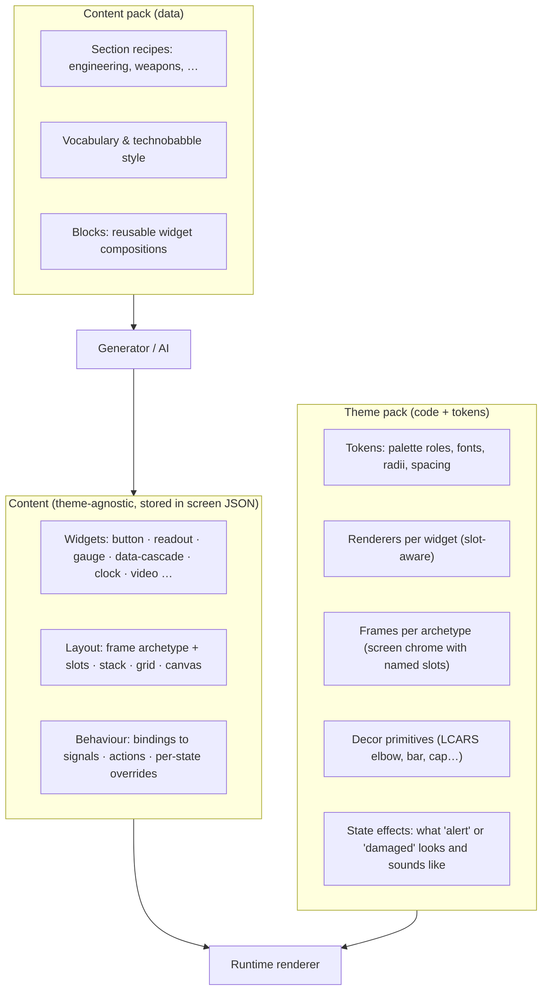
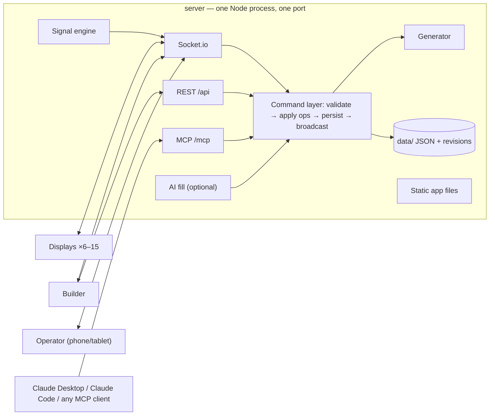
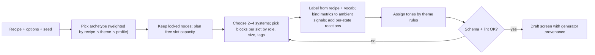

# Interactive Displays v2 — Greenfield Design

> **Status:** design proposal for review. This is a **greenfield** design: it takes the product requirements
> from the existing brainstorm and plan and does not assume anything about the current source code.
> Comment on the PR; decisions that need an owner call are collected in [§18](#18-decisions-needed).

## 1. Summary

The product is unchanged: sci-fi interfaces for video production, shown on 6–15 browser displays at once,
driven by a non-technical operator, touched by actors, and designed in a visual editor. What is new is what
the system must be able to do: change the whole look (LCARS today, something completely different later),
generate a sensible screen for a ship section in one click, and let AI fill in or edit screens.

All three need the same foundation: **the system stores what is on a screen, not how it is drawn.** A screen
is a tree of semantic widgets (a nav list, a readout, a gauge, a data cascade); a **theme pack** decides how
those widgets look, adds its own chrome and decoration, and defines what "red alert" means visually. A
generator and an AI can reason about meaning; neither can reason about a pile of coloured shapes.

Key decisions:

1. **One document model, one schema source.** Screens are small trees of layout containers and widgets,
   defined with Zod in a pure-TypeScript `core` package. The same schema produces the TS types, server
   validation, the editor's property panel, MCP/AI tool schemas, and contract tests. Adding a widget is one
   definition file plus (optionally) one renderer per theme.
2. **Theme packs, not colour sets.** A theme provides tokens *and* renderers, frames (screen chrome with
   named slots), theme-only decoration primitives (LCARS elbows and bars), state effects, fonts and sounds.
   A neutral `base` theme renders every widget, so a new theme only overrides what it wants. Documents store
   colour *roles* (`primary`, `accent`, `danger`), never hex values.
3. **Fluid, resolution-independent layout.** Screens re-flow to any display size and aspect ratio.
4. **Deterministic one-click generator.** Pick a section (engineering, environmental, weapons…) and a seeded
   generator combines a *section recipe* (vocabulary, metrics, actions), a *layout archetype* and reusable
   *blocks* into a complete, editable, touch-safe screen. Reroll, lock parts, regenerate the rest, or generate
   a whole linked suite of screens for a station. Works offline and costs nothing.
5. **AI on top, through one command layer.** Every change (editor, operator, generator, AI) is a validated
   operation applied by the server. An **MCP endpoint** exposes those same commands, so Claude (or any MCP
   client) can read, generate, edit, and create reusable elements; an optional built-in "Fill with AI" button
   uses the same tools. Drafts vs. published screens keep AI and editors from changing a display mid-take.
6. **One process, one port, one container.** The server serves the app, the API, the WebSocket channel and
   MCP. `docker run -v ./data:/data -p 3010:3010 …` is the whole deployment, and nothing needs the internet on set.
7. **Phased delivery** ([§17](#17-roadmap)): a deployable walking skeleton first, then the LCARS theme, editor
   and operator console, live data, the generator, AI/MCP, and finally a second, completely different UI family.

## 2. Goals and non-goals

| # | Goal (from the request) | How this design meets it |
|---|---|---|
| G1 | **Maintainable** | One schema source; a widget registry instead of per-element switch statements; most logic in a pure `core` package that is easy to unit-test; contract tests generated for every widget × theme. |
| G2 | **Easy to manage** | Shows (productions) as folders; screen library; operator console separate from the editor; display assignment from a phone; revisions with one-click revert; export/import a show as one file. |
| G3 | **Easy to deploy** | Single process and port, Docker image (amd64 + arm64), compose file, no internet dependency, QR codes to connect displays. |
| G4 | **Versatile look** | Theme packs with their own renderers, frames, decor, state effects, fonts and sounds; semantic colours; neutral base theme as fallback. |
| G5 | **Completely different UI later** (next phase, keep in mind) | Widgets are theme-agnostic; frames are mapped by archetype; decor is theme-scoped; a second theme is an explicit roadmap phase with exit criteria. |
| G6 | **One-click UI per section** | Seeded generator over recipes + archetypes + blocks; reroll, lock, regenerate, generate a suite. |
| G7 | **Partial manual + AI fill** | Locked nodes and `placeholder` widgets with an intent ("plasma flow diagnostics here"); the generator fills empty slots, AI fills intents. |
| G8 | **MCP so AI can manipulate the UI and create elements** | `/mcp` endpoint over the shared command layer; AI can create blocks (composite elements), recipes, sanitised SVG shapes and theme variants without code. |

Non-goals: multi-tenant cloud hosting, user accounts beyond an optional shared editor token, real-time
collaborative editing with CRDTs (optimistic revisions are enough for one person plus one agent), native
mobile apps, and arbitrary AI-written JavaScript running on displays.

## 3. Requirements carried over from the existing plans

The brainstorm and the first plan remain the product brief. Everything below is a requirement for v2.

| Area | Requirement | Source |
|---|---|---|
| Scale | 6–15 simultaneous browser displays on one LAN, one server | brainstorm, plan |
| Sync | State changes visible on all displays within 100 ms; auto-reconnect; late joiners get current state | plan (success metrics, acceptance) |
| Operator | Non-technical crew, large single-tap triggers, usable after 5 minutes of training | brainstorm, plan |
| States | Normal, red alert, active, damaged, **plus custom states per production** | brainstorm |
| Actors | Touch with < 50 ms feedback, ≥ 60 px targets, hybrid scripted and "safe freeform" interaction | brainstorm, plan |
| Editor | Visual drag-and-drop builder, snapping, resizing, live preview on real displays, undo | brainstorm, plan |
| Look | Colour scheme selection and randomisation, technobabble text generation, LCARS first | brainstorm |
| Elements | Shapes (elbow, bar, frame, bracket, divider), data displays (text, numbers, bar graph, status lights, data grid), interactive (button, slider, toggle, touch zone), composites (schematic, chart, alert banner), remote-controlled video | brainstorm, plan |
| Data | Static, animated (pulse, blink, scroll), live feeds (time, plausible sensor values), scripted sequences | brainstorm |
| Reliability | Zero unplanned display outages during takes; works offline / through network blips | brainstorm, plan |
| Persistence | Human-readable JSON files, no database, no cloud, trusted LAN | brainstorm, plan |
| Performance | 60 fps animations; limit heavy media (2–3 videos per screen) | plan |
| Process | TDD, small conventional commits with gitmoji, plan deviations recorded | AGENTS.md |
| Open questions | Asset management, multiple productions, audio | brainstorm (answered in [§20.4](#204-brainstorm-open-questions-answered)) |

Plan-level decisions that **change** in v2, because they block the new goals:

- *"5 LCARS elements only"* becomes a widget catalog plus theme-specific decor.
- *A fixed 4-value state enum* becomes show-defined states with theme-defined effects.
- *A fixed 12-column pixel grid* becomes fluid layout with screen profiles.
- *Per-element colour values* become colour roles resolved by the theme.
- *"Agent-native API, MCP tools, Docker" deferred to v3+* become first-class parts of the design.

## 4. The core idea: meaning vs. look



- **Widgets** say *what* something is: "a list of navigation buttons", "a readout of warp core output in %",
  "a scrolling cascade of numbers". They never mention elbows or hex colours.
- **Themes** decide *how* it looks. LCARS renders a nav list in the sidebar slot as flush coloured blocks
  with right-aligned labels; a future CRT theme renders the same list as inverse-video menu lines.
- **Content packs** hold the words: what engineering is about, which buttons make sense on a weapons
  console, how numbers are formatted. They are data, so AI can write new ones.

Switching a show from LCARS to another theme re-renders every widget natively, swaps the chrome by
archetype, and hides LCARS-only decoration (or maps it, if the new theme declares a mapping).

## 5. Architecture

### 5.1 Stack

| Concern | Choice | Why |
|---|---|---|
| Language | TypeScript, strict, everywhere | one language for server, client, schemas and themes; AI tools write it well |
| Runtime | Node.js 24 LTS | long-term support for a box that must not break on set |
| Server | Fastify 5 + Socket.io 4 | fast, plugin-based HTTP; Socket.io gives reconnection, rooms and acks for free |
| Schemas | Zod 4 | one definition → types, runtime validation, JSON Schema (for MCP and AI), editor metadata via `.meta()` |
| UI | React 19 + Vite | mature ecosystem for editors (drag-and-drop, forms); theme renderers are plain components that AI can write |
| Editor DnD | dnd-kit | touch-capable, sortable lists for slots and stacks |
| MCP | official MCP TypeScript SDK, Streamable HTTP | connect from Claude Desktop/Code by URL |
| AI (optional) | Anthropic TypeScript SDK, tool runner | same Zod schemas become tool definitions |
| Tests | Vitest, fast-check (property tests), Playwright (e2e + visual) | |
| Quality | oxlint, knip, import-boundary lint rule, husky + lint-staged | |
| Packaging | pnpm workspaces, Docker multi-stage image | |

Rendering stays DOM + SVG (not canvas/WebGL) for native touch handling and easy theming, as the first plan
decided; a theme may still use canvas inside an individual renderer for effects.

### 5.2 Packages

```
packages/
  core/      @interactive-displays/core     pure TS (no React, no Node APIs); runs in browser and server
             schema/      Zod schemas: Show, Screen, Node, Op, Signal, Action, Recipe, Block
             catalog/     defineWidget() registry + all widget definitions
             ops/         apply / invert / validate operations, revisioning
             generator/   seeded generator, archetype fillers, tone assignment
             lint/        structural lint (counts, label length vs slot, missing bindings)
             migrate/     document schema migrations for future versions
             protocol/    typed Socket.io events + REST payloads
  themes/    @interactive-displays/themes
             base/        neutral theme: renders every widget; also the editor's "wireframe" mode
             lcars/       manifest.ts (pure data) + react/ (renderers, frames, decor) + fonts/ + sounds/
  server/    Fastify: REST, Socket.io, MCP, command layer, persistence, signal engine, AI fill, static app
  app/       React SPA, lazy routes: /d/:displayId · /builder · /operator · /gallery
content/     default content packs (data, versioned with code): trek/recipes, trek/vocab, blocks
```

Each theme has two entry points: `manifest` (pure data, readable by the server, generator and MCP) and
`react` (renderers, loaded only in the browser). Import boundaries are enforced with a lint rule: `core`
imports nothing app- or Node-specific; theme manifests import only `core`; the server imports `core` and
manifests; only `app` imports theme renderers.

Themes live in one package (not one package per theme) until there is a reason to publish them separately;
the folder boundary keeps that move cheap.

### 5.3 Runtime topology



The **command layer** is the single write path. It validates input against the `core` schemas, applies
operations, bumps the revision, persists, and broadcasts. REST, Socket.io, MCP and the built-in AI are thin
adapters over it, so anything a person can do in the editor an agent can do through MCP and vice versa
(parity is tested, [§15](#15-maintainability-and-quality)).

### 5.4 Glossary

| Term | Meaning |
|---|---|
| **Show** | A production. Holds theme choice, states, signals, screens, displays, blocks, assets. One is active. |
| **Screen** | One designed UI. A document with a node tree, a profile and revisions. |
| **Display** | A physical browser client (TV, tablet, monitor). Gets assigned a screen by the operator. |
| **Widget** | Theme-agnostic UI element defined in `core` (button, readout, gauge…). |
| **Decor** | Theme-specific ornament with no meaning (LCARS elbow, bar, end cap). |
| **Frame / archetype** | Screen skeleton with named slots (`title`, `nav`, `main`, `status`…); each theme draws its own chrome for it. |
| **Block** | A saved, reusable composition of widgets ("warp core panel"). The no-code way to make new elements. |
| **Recipe** | Data describing a section (engineering…) for the generator: systems, metrics, actions, labels. |
| **Signal** | A named live value (`warp.output`) that widgets bind to; ambient (client-side noise) or shared (server). |
| **State** | Show-wide mode (normal, red alert, damaged…) with a visual effect defined by the theme. |

## 6. Document model

All of the following are Zod schemas in `core/schema`; TypeScript types are `z.infer` of them.

### 6.1 Show

```ts
interface Show {
  schemaVersion: 1
  id: string
  name: string
  theme: { id: string; variant?: string; tokens?: Partial<ThemeTokens> } // e.g. { id: 'lcars', variant: 'tng' }
  content: string[]                 // content packs in use, e.g. ['trek']
  states: StateDef[]                // data-driven, defined per production
  signals: SignalDef[]              // shared live values
  displays: DisplayDef[]            // known displays, their names and assigned screen
  settings: {
    liveEdit: boolean               // false = edits go to drafts until published (default)
    displayGlobalActions: boolean   // may display buttons change show state? (otherwise per-button opt-in)
    ai: { mcp: boolean; allowPublish: boolean; allowLiveControl: boolean }
  }
}

interface StateDef {
  id: string                        // 'normal' | 'red-alert' | 'yellow-alert' | 'intruder' | …
  label: string
  effect: 'none' | 'warning' | 'alert' | 'damaged' | 'blackout'   // the theme decides what each looks like
  banner?: string                   // e.g. 'RED ALERT' for alert-banner widgets
  sound?: string                    // theme sound id, e.g. 'klaxon'
}
```

### 6.2 Screen and nodes

```ts
interface Screen {
  schemaVersion: 1
  id: string
  name: string
  section?: string                  // 'engineering'
  tags: string[]
  profile: { aspect: '16:9' | '4:3' | '21:9' | '9:16' | '16:10'; fit: 'fluid' | 'contain' }
  revision: number                  // optimistic concurrency + history
  published?: number                // revision shown on displays
  generator?: { recipe: string; archetype: string; seed: number; density: 'sparse' | 'normal' | 'dense' }
  root: Node
}

type Node = ContainerNode | WidgetNode | DecorNode

interface NodeBase {
  id: string
  locked?: boolean                  // generator and AI must not change it
  hidden?: boolean
  when?: Array<{ state: string; props?: Record<string, unknown>; hidden?: boolean }>  // per-state overrides
}

interface ContainerNode extends NodeBase {
  type: 'container'
  layout:
    | { kind: 'frame'; archetype: string }                         // theme draws chrome, children fill slots
    | { kind: 'stack'; direction: 'row' | 'column'; gap?: Space }  // flex, children have weights
    | { kind: 'grid'; columns: Track[]; rows: Track[] }            // fr tracks, children have areas
    | { kind: 'canvas' }                                           // free placement, normalised 0..1 rects
  children: Array<{ node: Node; slot?: string; weight?: number; area?: GridArea; rect?: NormRect }>
}

interface WidgetNode extends NodeBase {
  type: 'widget'
  kind: string                      // a catalog kind: 'button', 'readout', 'gauge', …
  props: Record<string, unknown>    // validated against the catalog schema for `kind`
  bind?: Record<string, Binding>    // prop → signal, e.g. { value: { signal: 'warp.output' } }
  actions?: Action[]
}

interface DecorNode extends NodeBase {
  type: 'decor'
  kind: string                      // theme-scoped: 'lcars.elbow', 'lcars.bar', or 'shape:<id>'
  props: Record<string, unknown>
}
```

Notes:

- **Colours are roles.** Widget props use `tone: 'primary' | 'secondary' | 'accent' | 'info' | 'neutral' |
  'success' | 'warning' | 'danger'`, plus a theme's extra named swatches such as LCARS `tan` or `salmon`.
  A raw hex override exists as an escape hatch but is flagged by lint.
- **Locks and placeholders** are the hand-off between people, the generator and AI. A `placeholder` widget
  carries `{ intent: 'plasma flow diagnostics', size?: 'small' | 'large' }`.
- **`canvas` keeps hand-made art possible.** Pixel-perfect LCARS compositions like the references in `design/`
  can be built by free placement; structured containers are for generated and adaptive screens.

### 6.3 Signals, bindings and actions

```ts
interface SignalDef {
  id: string                        // 'warp.output'
  label: string
  unit?: string                     // '%', 'K', 'GW'
  scope: 'shared' | 'ambient'       // shared = server-owned, same everywhere; ambient = computed per client
  source:
    | { kind: 'static'; value: number | string }
    | { kind: 'walk'; min: number; max: number; volatility: number }   // random walk
    | { kind: 'wave'; min: number; max: number; periodMs: number }
    | { kind: 'clock'; format: 'time' | 'stardate' | 'countdown'; target?: string }
    | { kind: 'manual' }            // only the operator / actions change it
  byState?: Record<string, Partial<SignalDef['source']>>  // e.g. red-alert: { min: 40, max: 120 }
}

type Binding = { signal: string } | { ambient: SignalDef['source'] }   // inline ambient for generated noise

type Action =
  | { do: 'navigate'; screen: string } | { do: 'back' }               // local to the display
  | { do: 'setState'; state: string }                                 // global, gated
  | { do: 'setSignal'; signal: string; value?: number; delta?: number }
  | { do: 'toggle'; target: string }                                  // local UI state (highlight, expand)
  | { do: 'video'; target: string; command: 'play' | 'pause' | 'seek' | 'load'; time?: number; src?: string }
  | { do: 'sound'; sound: string }
  | { do: 'cue'; cue: string }                                        // later: scripted scene cues
```

Every button without actions still gets a flash and a press sound, so actors always get feedback (the
brainstorm's "safe freeform" interaction).

**Ambient vs shared signals.** Most numbers on sci-fi screens are decoration; they should move, but nobody
cares if two screens disagree. Ambient signals run in each client from a seed (the node id), cost no network,
and keep animating if the server disappears. Shared signals (the shield level the story depends on) are owned
by the server, ticked at ≤ 10 Hz in batched updates, and controllable from the operator console.

### 6.4 Example (abridged, generated engineering screen)

```json
{
  "schemaVersion": 1,
  "id": "eng-main",
  "name": "Main Engineering",
  "section": "engineering",
  "profile": { "aspect": "16:9", "fit": "fluid" },
  "revision": 7,
  "published": 7,
  "generator": { "recipe": "trek/engineering", "archetype": "sidebar", "seed": 48213, "density": "normal" },
  "root": {
    "id": "root", "type": "container", "layout": { "kind": "frame", "archetype": "sidebar" },
    "children": [
      { "slot": "title", "node": { "id": "t1", "type": "widget", "kind": "title",
        "props": { "text": "Main Engineering", "code": "ENG 04-7731" } } },
      { "slot": "nav", "node": { "id": "n1", "type": "widget", "kind": "button-group",
        "props": { "items": ["Warp Core", "EPS Grid", "Impulse", "SIF", "Damage Control"], "tone": "auto" },
        "actions": [{ "do": "navigate", "screen": "eng-warp" }] } },
      { "slot": "main", "node": { "id": "m1", "type": "container",
        "layout": { "kind": "grid", "columns": ["2fr", "1fr"], "rows": ["1fr", "1fr"] },
        "children": [
          { "area": { "col": 1, "row": 1 }, "node": { "id": "g1", "type": "widget", "kind": "gauge",
            "props": { "label": "Core Output", "unit": "%", "min": 0, "max": 120, "variant": "segmented" },
            "bind": { "value": { "ambient": { "kind": "walk", "min": 92, "max": 99, "volatility": 0.2 } } },
            "when": [{ "state": "red-alert", "props": { "tone": "danger" } }] } },
          { "area": { "col": 2, "row": 1 }, "node": { "id": "c1", "type": "widget", "kind": "data-cascade",
            "props": { "columns": 4, "speed": "normal" } } },
          { "area": { "col": 1, "row": 2, "colSpan": 2 }, "node": { "id": "p1", "type": "widget",
            "kind": "placeholder", "props": { "intent": "antimatter containment status" } } }
        ] } },
      { "slot": "status", "node": { "id": "s1", "type": "widget", "kind": "clock", "props": { "format": "stardate" } } },
      { "slot": "decor", "node": { "id": "d1", "type": "decor", "kind": "lcars.bar", "props": { "tone": "tan" } } }
    ]
  }
}
```

## 7. Widget catalog and registry

### 7.1 One definition, many uses

```ts
// core/catalog/readout.ts
export const readout = defineWidget({
  kind: 'readout',
  label: 'Readout',
  category: 'data',
  props: z.object({
    label: z.string().max(40).meta({ control: 'text' }),
    value: z.union([z.number(), z.string()]).optional(),
    unit: z.string().max(8).optional(),
    precision: z.number().int().min(0).max(4).default(1),
    tone: Tone.default('secondary'),
  }),
  bindable: ['value'],
  slots: ['main', 'aside', 'status'],          // where the generator/editor may put it
  size: { min: [2, 1], preferred: [3, 1] },    // layout units, used by generator and lint
})
```

From that one definition the system derives:

1. TypeScript types (`z.infer`).
2. Server and client validation, including operations from MCP and AI.
3. The editor inspector: a form generated from the schema, where `.meta({ control })` picks colour-role
   pickers, signal pickers, segmented enums and so on.
4. JSON Schema for MCP tools and the Claude API (`z.toJSONSchema`).
5. Defaults for new nodes and constraints for the generator.
6. Contract tests: every widget × every theme renders its defaults, every state, and a fuzzed prop set
   without throwing; every schema round-trips.

**Adding a widget = one file in `core/catalog` + its test, and optionally a renderer in a theme.** No
per-element switch statements in renderers, editors or validators.

### 7.2 Widget set

| Group | Widgets | Notes |
|---|---|---|
| Layout | `frame`, `stack`, `grid`, `canvas`, `panel` (titled, bordered group) | containers |
| Text | `title`, `text`, `label-code` (LCARS-style number codes), `technobabble` (generated filler text) | |
| Controls | `button`, `button-group`, `toggle`, `slider`, `keypad`, `touch-zone` | ≥ 60 px touch targets |
| Data | `readout`, `gauge` (bar / arc / segmented), `bar-graph`, `sparkline`, `status-light`, `status-matrix`, `data-cascade`, `data-grid`, `clock` (time / stardate / countdown) | |
| Media | `video` (remote-controlled; commands queued per element so rapid play/seek don't race), `image` (schematic, later with callouts) | |
| Alerts | `alert-banner` | shows the current state's banner text |
| Meta | `placeholder` | intent for the generator or AI to fill |

LCARS-specific shapes from the brainstorm (elbow with asymmetric arms, bar with round/square/pointed caps,
bracket, divider, sweep) are **LCARS decor**, not widgets, because another theme has no use for them.

## 8. Theme system

### 8.1 What a theme pack contains

```ts
// themes/lcars/manifest.ts  (pure data — readable by server, generator and MCP)
export const lcars = defineTheme({
  id: 'lcars',
  name: 'LCARS',
  extends: 'base',
  variants: { tng: {/* tokens */}, voyager: {/* tokens */}, 'nemesis-blue': {/* tokens */} },
  tokens: {
    palette: { primary: '#ff9900', secondary: '#ffcc99', accent: '#cc99cc', info: '#9999ff',
               danger: '#ff3333', tan: '#cc9966', salmon: '#ff9999' },
    font: { display: 'Antonio', data: 'Antonio' },
    radius: 'pill', gap: 'tight', textCase: 'upper',
  },
  toneRules: { adjacentDiffer: true, navCycle: ['secondary', 'accent', 'info', 'tan'] },
  states: {                                   // what each StateDef.effect looks like here
    warning: { tokens: { primary: '#ffcc00' } },
    alert:   { tokens: { primary: '#ff3333', secondary: '#ff6666' }, animation: 'pulse', sound: 'klaxon' },
    damaged: { filter: 'flicker', tokens: { primary: '#776655' } },
    blackout:{ hideAll: true },
  },
  archetypes: ['sidebar', 'header-main', 'dashboard', 'split', 'media', 'console'],
  slotStyles: { nav: { button: 'block' }, toolbar: { button: 'pill' } },
  decor: { elbow: ElbowSchema, bar: BarSchema, cap: CapSchema, bracket: BracketSchema },
  generator: { numberFormat: 'NN-NNNN', maxLabelChars: 18, density: 'dense', labelCase: 'upper' },
  fonts: ['fonts/Antonio-Regular.woff2', 'fonts/Antonio-Bold.woff2'],
  sounds: { press: 'sounds/beep-1.mp3', klaxon: 'sounds/red-alert.mp3' },
})

// themes/lcars/react/index.ts  (browser only)
export const lcarsRenderers = defineRenderers('lcars', {
  frames: { sidebar: LcarsSidebarFrame, 'header-main': LcarsHeaderFrame, dashboard: LcarsDashboardFrame },
  widgets: { button: LcarsButton, 'button-group': LcarsButtonGroup, readout: LcarsReadout,
             'data-cascade': LcarsCascade, title: LcarsTitle },   // everything else falls back to base
  decor: { elbow: LcarsElbow, bar: LcarsBar, cap: LcarsCap, bracket: LcarsBracket },
})
```

### 8.2 How rendering works

- **Tokens are CSS custom properties** on the screen root, scoped by `data-theme` and `data-state`.
  A state change is one attribute change on the root; the theme's `[data-state=alert]` rules swap tokens and
  start CSS animations. Nothing in React re-renders for a state change, which keeps the 100 ms budget easy.
- **Renderers are React components** receiving resolved props (bindings already applied), the **slot role**
  they sit in, the current state, and a size class from container queries. Slot awareness is what makes
  generated LCARS look authentic: a `button` in the `nav` slot renders as a flush block in the sidebar sweep;
  in a `toolbar` slot it is a pill; in a CRT theme it is a bracketed menu line.
- **Frames** are the theme's chrome for an archetype (for LCARS: the elbow-and-bar sweep around the content).
  They expose the same slot names in every theme, which is what lets a screen move between themes.
- **Fallback chain:** theme renderer → parent theme (`extends`) → `base`. A new theme can start with only
  tokens and frames and still render every widget.
- **Decor** nodes render only in their own theme. On theme switch they are hidden, not deleted (the editor
  shows "4 LCARS decor elements hidden"), unless the new theme declares a `decorMap` (`lcars.elbow → crt.corner`).

### 8.3 Ready for a completely different UI

Nothing in widgets, recipes, signals or actions refers to LCARS. A new UI family (for example a retro CRT
terminal à la *Alien*, a flat translucent HUD à la *The Expanse*, or a military tactical display) is a new
folder under `themes/` with tokens, frames, renderers, decor and sounds, plus optionally its own content pack
for vocabulary. Renderers are ordinary React components, so a theme that needs canvas or WebGL effects
(scanlines, glow, bloom) can use them internally without changing the document model.

To keep the abstraction honest from day one, the `base` theme exists from the walking skeleton onwards and the
editor can preview any screen in it ("wireframe mode"). If something only renders correctly in LCARS, that is a bug.

### 8.4 Theme variants without code

A **theme variant** is a token overlay (palette, fonts from the theme's set, radius, density). Variants can be
created in the editor or by AI through MCP and stored in the show. This covers "LCARS, but the blue Nemesis era"
and the brainstorm's colour scheme selection and randomisation, without touching renderers.

## 9. Layout and resolution independence

- Containers are fluid: frames and grids use `fr` tracks, stacks use weights, canvas uses normalised rects.
- A root scale unit derived from the display size drives type, stroke widths, radii and gaps, so a screen
  designed at 16:9 looks proportionally the same on a 4K TV and a 1080p monitor.
- Widgets use container-query units so labels and numbers fit their box rather than the viewport.
- Each screen has a **profile** (aspect + fit). `fluid` re-flows to the real aspect; `contain` letterboxes for
  pixel-exact art. The editor previews any profile side by side (16:9 TV, 4:3 tablet, 9:16 portrait).
- **Lint** checks what can be checked without a browser in `core` (label length vs slot, widget counts, empty
  slots, missing bindings, hex overrides), and does geometric checks (touch target ≥ 60 px at the profile size,
  text overflow) in the browser runtime: live in the editor, and headless for MCP previews.

## 10. One-click generation

### 10.1 Inputs

| Input | Example | Source |
|---|---|---|
| Section recipe | `trek/engineering` | content pack (data) |
| Theme manifest | LCARS archetypes, tone rules, label rules | theme |
| Profile | 16:9, touch | screen / display |
| Density | sparse · normal · dense | user |
| Seed | 48213 | random, shown and editable |
| Locked nodes / placeholders | the user's header and one gauge | existing screen |

### 10.2 Section recipe (data)

```json
{
  "id": "trek/engineering",
  "label": "Engineering",
  "archetypes": { "sidebar": 3, "dashboard": 2, "media": 1 },
  "titles": ["Main Engineering", "Warp Propulsion Status", "Power Distribution"],
  "systems": [
    { "id": "warp-core", "label": "Warp Core",
      "metrics": [
        { "id": "output", "label": "Core Output", "unit": "%", "range": [92, 99], "alertRange": [60, 120], "widgets": ["gauge", "readout"] },
        { "id": "containment", "label": "Antimatter Containment", "unit": "%", "range": [99.2, 100], "alertRange": [40, 85] }
      ],
      "actions": [{ "label": "Eject Core", "danger": true }, { "label": "Purge Plasma" }] },
    { "id": "eps", "label": "EPS Grid", "metrics": [{ "id": "load", "label": "Grid Load", "unit": "GW", "range": [3.2, 4.1] }] },
    { "id": "sif", "label": "Structural Integrity", "metrics": [{ "id": "field", "label": "SIF Strength", "unit": "%", "range": [97, 100], "alertRange": [30, 70] }] }
  ],
  "nav": ["Warp Core", "EPS Grid", "Impulse", "SIF", "Inertial Dampers", "Damage Control", "Diagnostics"],
  "blocks": { "prefer": ["gauge-panel", "readout-stack", "data-cascade", "schematic"] },
  "alert": { "banner": true, "emphasise": ["containment", "field"] }
}
```

The default content pack ships at least 8 sections: engineering, environmental (life support), tactical/weapons,
helm/navigation, science/sensors, medical, communications, security, operations. Each is one JSON file, so adding
"Hydroponics" or "Cargo Bay" is a data change, which AI can write ([§11.4](#114-ai-creating-new-elements)).

### 10.3 Algorithm



1. Seeded PRNG: identical inputs produce an identical screen (reproducible, testable, diffable).
2. The archetype is chosen from recipe weights, filtered by what the theme supports and by the profile
   (portrait prefers stacked archetypes).
3. Slots are filled from **blocks** (reusable compositions: `gauge-panel` = panel + gauge + 2 readouts,
   `action-panel` = danger buttons with confirm, `status-matrix`, `readout-stack`, `data-cascade`…), matched by
   slot role, size and tags.
4. Labels come from the recipe; filler codes, numbers and technobabble come from the content pack's vocabulary,
   in the theme's number format (`ENG 04-7731`).
5. Metrics bind to ambient signals with the recipe's ranges; `alertRange` becomes a `byState` override, so red
   alert makes the right gauges swing and turn `danger` without extra work.
6. Tones are assigned by the theme's rules (LCARS: adjacent blocks differ, nav cycles through a palette).
7. Every output is schema-validated and linted; a failing subtree is regenerated with a sub-seed.

### 10.4 What the user can do with it

- **Generate**: section + theme + profile → three variant thumbnails → pick one → editable draft.
- **Reroll** the whole screen or one panel (new sub-seed); undo is a revision revert.
- **Lock** anything they like (padlock on the node) and **regenerate unlocked**.
- **Leave intents**: drop a `placeholder` with a sentence; the generator fills it with the best matching block,
  or AI fills it precisely ([§11](#11-ai-mcp-and-fill-with-ai)).
- **Generate a suite**: one overview screen plus one screen per system, with nav buttons already wired to
  `navigate` between them, so actors can tap through a believable station.

This turns the original success metric "a new screen layout in under 30 minutes" into "a new screen in one click,
polished in minutes".

### 10.5 Why deterministic first, AI second

It works offline on set, is instant, free, testable with snapshots and property tests, and its output is always
valid. AI is used where it is actually better: writing new recipes and blocks (reusable, so they pay off forever),
filling specific intents, and free-form requests. Both go through the same command layer and lint.

## 11. AI: MCP and "Fill with AI"

### 11.1 MCP endpoint

The server mounts an MCP endpoint at `/mcp` using the official MCP TypeScript SDK with the Streamable HTTP
transport, so Claude Desktop, Claude Code or any MCP client connects by URL (optionally with the editor token).
Tool handlers are thin wrappers over the command layer.

| Group | Tools | Notes |
|---|---|---|
| Discover | `get_catalog(theme?)`, `get_theme(id)`, `list_screens`, `get_screen(id, format: full \| outline)`, `list_recipes`, `list_blocks`, `list_displays` | JSON Schemas included so the model writes valid props |
| Generate | `generate_screen(section, options)`, `generate_suite(section, options)`, `regenerate(screenId, scope: node ids \| unlocked, seed?)` | deterministic generator; returns an outline + lint |
| Edit | `apply_ops(screenId, baseRevision, ops[])` | one atomic batch tool; errors come back with JSON paths so the model can self-correct |
| Check | `lint_screen(screenId, profile?)`, `render_preview(screenId, profile, state)` → PNG | preview uses headless Chromium (optional image) |
| Library | `save_block`, `save_recipe`, `save_shape` (sanitised SVG), `save_theme_variant` | the "create new elements" path |
| Live (gated) | `publish_screen`, `assign_screen(displayId, screenId)`, `set_state`, `set_signal`, `video_command` | off by default: `settings.ai.allowPublish / allowLiveControl` |

Resources: `catalog`, `themes/{id}`, `screens/{id}`, `recipes/{id}`, and a `guides/design-rules` text with the
theme's design rules (LCARS conventions, label lengths, touch sizes) so generated content stays on-style.
Prompts: `design-screen`, `fill-placeholders`, `new-section-recipe`.

An example session from Claude Desktop: *"Make an environmental screen for the bridge display, life support
emphasis, keep my header from eng-main."* → `get_screen(eng-main, outline)` → `generate_screen('environmental',
{ archetype: 'sidebar' })` → `apply_ops` to copy the locked header → `lint_screen` → `render_preview` → the draft
appears live in the editor for a person to publish.

### 11.2 Built-in "Fill with AI" (optional)

For people who do not run an MCP client, the editor gets a **Fill with AI** button (placeholders, empty slots, or
a free-text instruction). The server runs a Claude tool loop over a *scratch copy* of the screen with a subset of
the same tools (`get_catalog`, `get_screen`, `apply_ops`, `lint_screen`) and returns the proposed ops as a diff
the user accepts or rejects. It is enabled only when `ANTHROPIC_API_KEY` is set.

Implementation sketch (Anthropic TypeScript SDK tool runner; the tool input schemas are the same Zod schemas as
everything else). Verify exact SDK calls against current docs at implementation time:

```ts
import Anthropic from '@anthropic-ai/sdk'
import { betaZodTool } from '@anthropic-ai/sdk/helpers/beta/zod'

const applyOps = betaZodTool({
  name: 'apply_ops',
  description: 'Apply a batch of screen operations to the scratch copy. Returns new revision or validation errors.',
  inputSchema: ApplyOpsInput,                      // from core/schema
  run: async (input) => JSON.stringify(await commands.applyOps(scratch, input)),
})

const final = await client.beta.messages.toolRunner({
  model: 'claude-opus-5-5',
  max_tokens: 16000,
  output_config: { effort: 'medium' },
  betas: ['server-side-fallback-2026-07-01'],
  fallbacks: 'default',
  system: designRulesForTheme(theme),              // stable → cacheable
  tools: [getCatalog, getScreen, applyOps, lintScreen],
  messages: [{ role: 'user', content: instruction }],
})
```

### 11.3 Safety rails

- **Drafts and publishing.** Displays render the published revision. The editor, generator and AI edit drafts.
  Publishing a screen that is on air asks for confirmation. `liveEdit` mode exists for rehearsals.
- **Everything is validated.** Ops from AI go through the same schemas and lint as human edits; invalid ops are
  rejected with paths, never partially applied.
- **Live control is opt-in** for AI (`allowLiveControl`) and for display buttons (`displayGlobalActions` or a
  per-button flag), so neither an agent nor an actor can trigger red alert unless intended.
- **No AI-authored code on displays.** New "elements" from AI are data: blocks, recipes, theme variants, and SVG
  shapes that pass an allow-list sanitiser (path/rect/circle/line/text, token colours only, no scripts, no
  external references, size cap).
- **Audit log** of who changed what (editor, operator, generator, AI via MCP) for on-set debugging.

### 11.4 AI creating new elements

Three tiers, from safest and most common to rarest:

1. **Blocks (no code).** A composite of existing widgets saved with a name and tags ("Warp core panel",
   "Torpedo loading bay"). It appears in the editor library and in the generator's block selection. Recipes and
   theme variants are the same kind of data.
2. **Shapes (no code).** Declarative, sanitised SVG decor with token colours, for new ornaments in the current
   theme's style.
3. **New widget kinds or themes (code).** A new renderer or widget is a repo change. The registry makes this a
   small, well-defined change, and Claude Code skills (`add-widget`, `add-theme`) document the exact files and
   tests, so Claude Code can open a PR for it.

## 12. Runtime: displays, sync, operator

### 12.1 Displays and assignment

- A display opens `/d/<displayId>`, or `/d/` and gets a short code shown on screen. The server remembers it
  (this is the brainstorm's "auto-discovery or operator selection").
- The operator names displays and assigns screens from the console; assignments live in `show.json` and survive
  restarts. A display follows reassignment instantly.
- **Identify**: the operator taps a display in the list and the physical screen flashes its name.
- Displays request fullscreen and a screen wake lock on first tap, hide the cursor, and reload themselves when the
  server reports a new protocol version after an upgrade.

### 12.2 Real-time protocol

Events are typed and validated in `core/protocol`.

- On connect a client sends `hello { role: 'display' | 'builder' | 'operator', displayId?, token? }` and receives a
  **snapshot** (show state, signal values, its screen, assignment). Reconnect means a new snapshot, so nothing is missed.
- Rooms: `display:<id>`, `screen:<id>`, `operators`, `builders`; nothing is broadcast to clients that don't need it.
- Shared signals are sent as batched deltas at ≤ 10 Hz; ambient signals never touch the network.
- The server persists runtime state (current show state, shared signal values, assignments) with debounced writes,
  so a server restart mid-shoot restores the scene.
- Budgets: state change visible on all displays < 100 ms, touch feedback < 50 ms, 60 fps animations on target hardware.

### 12.3 Operator console (`/operator`)

Separate from the editor and built for a phone or tablet in a crew member's hand:

- Big state buttons generated from the show's `states`, including a **blackout** panic button.
- Display list with live mini previews, assign dropdown, identify, reload.
- Pinned shared signals as sliders ("forward shields"), video transport for video widgets.
- QR codes for display URLs, so a tablet joins by scanning.
- Later: a cue list for scenes (`GO` runs a bundle of state, signal, screen and video changes). This covers the
  brainstorm's "scripted sequences".

### 12.4 Offline resilience

Self-hosted fonts and assets; a service worker caches the app shell and the last snapshot, so a display that
reloads while the server is down still shows its screen with ambient animation.

## 13. Editor

```
┌ Library ─────────┐┌ Preview (real renderer, any theme/profile/state) ┐┌ Inspector ───────────┐
│ Widgets          ││                                                   ││ generated from schema│
│ Blocks           ││     ╭───────╮━━━━━━━━━━━━━━━━  MAIN ENGINEERING   ││ tone ▸ role picker   │
│ LCARS decor      ││     │ WARP  │                                     ││ value ▸ signal picker│
│ Shapes           ││     │ EPS   │  [gauge]  [cascade]                 ││ when red-alert ▸ …   │
├ Outline ─────────┤│     │ SIF   │  [ placeholder: containment ]       ││ actions ▸ navigate … │
│ ▾ frame:sidebar  ││     ╰───────╯━━━━━━━━━━━━━━━━  STARDATE 48213.4   ││ 🔒 locked            │
│   title 🔒       ││                                                   │├ Lint ─────────────────┤
│   nav            ││  [16:9] [4:3] [9:16]   state: normal ▾  theme ▾   ││ ⚠ label too long     │
│   main ▸ grid    │└───────────────────────────────────────────────────┘└──────────────────────┘
└──────────────────┘   Generate ▾   Reroll   Regenerate unlocked   Fill with AI   Publish
```

- **One renderer.** The preview is the display runtime itself, so what you see in the editor is what the displays show.
- Drop widgets into slots or stacks (sortable), or position freely inside a `canvas` container with snapping.
- Screen library with thumbnails, tags, search and duplicate.
- Every change is an op sent to the server; undo/redo is per-session op history, and **revisions** let you revert
  to any earlier version (including AI edits). AI edits made through MCP appear live.
- "Send to display" previews a draft on one physical display without publishing it (the brainstorm's live preview).
- Asset upload (images, video, schematics) into the show's `assets/`.
- Code-split: the display bundle does not include editor code or drag-and-drop libraries.

## 14. Persistence

JSON files on disk (human-readable, git-friendly, no database), organised per show and behind a small repository
interface so a different store is possible later without touching callers.

```
data/
  settings.json                 active show, optional editor token hash
  shows/<show-id>/
    show.json                   theme, states, signals, displays, settings
    runtime.json                last state, shared signal values (debounced)
    screens/<screen-id>.json
    screens/.history/<screen-id>/<revision>.json     last N revisions (default 50)
    blocks/*.json  recipes/*.json  shapes/*.json  variants/*.json
    assets/
```

- Atomic writes (temp file + rename) and strict id validation so ids can never escape the data directory.
- Optimistic concurrency: ops carry `baseRevision`; a stale write gets the current revision back and the client
  rebases (editor) or retries (AI). Good enough for one person plus one agent per screen.
- Documents carry `schemaVersion` from day one; `core/migrate` upgrades older documents on read, with fixture tests
  for every migration, so the format can evolve without breaking saved shows.
- **Export/import** a whole show as one `.zip` (show + screens + library + assets) for backup and for moving between
  machines.

## 15. Maintainability and quality

- **Boundaries:** `core` (pure) ← theme manifests ← `server`; theme renderers ← `app`. Enforced by lint rules.
- **Single schema source** (Zod 4 with `.meta()`), generated JSON Schemas for MCP and the API docs.
- **Testing pyramid** (TDD as in `AGENTS.md`):
  - `core` unit tests: schemas, ops (apply/invert), migrations, lint.
  - Generator: snapshot tests per recipe with fixed seeds, and property tests over random seeds (every output
    validates, passes lint, has unique nav labels, respects slot capacities).
  - Contract matrix: every widget × every theme × every state effect renders without error. It is generated from
    the registry, so new widgets are tested by default.
  - Command-layer parity: the same scenario run through REST, Socket.io and an in-process MCP client produces the
    same documents.
  - Playwright: e2e flows (generate → edit → publish → display updates; operator assigns; reconnect snapshot) and
    visual snapshots of the `/gallery` route per theme.
- **`/gallery` route** renders every widget, block and archetype in every theme and state. It is the design review
  page, the visual-regression fixture, and what `render_preview` uses.
- **Docs and agent guidance:** `AGENTS.md` and `.claude/skills/*` are rewritten for this architecture in Phase 0, with
  `add-widget`, `add-theme` and `write-recipe` skills. Architecture decisions are recorded in `docs/solutions/architecture/`.
- **Observability:** structured logs (pino via Fastify), `/health` with connected displays and versions, and the audit
  log from [§11.3](#113-safety-rails).

## 16. Deployment

- **Single process.** The server serves the built app with `@fastify/static` alongside `/api`, Socket.io and `/mcp` on
  one port. Clients connect to their own origin, so there is no build-time server URL and no CORS setup.
- **Docker.** Multi-stage `Dockerfile` (build with pnpm, run on `node:24-slim`, non-root user, `VOLUME /data`,
  `HEALTHCHECK` on `/health`), published to GHCR for `amd64` and `arm64` (Raspberry Pi 5, Apple silicon). A `-full`
  tag adds Chromium for `render_preview`.

  ```yaml
  # docker-compose.yml
  services:
    displays:
      image: ghcr.io/ra100/interactive-displays:latest
      ports: ["3010:3010"]
      volumes: ["./data:/data"]
      environment:
        EDITOR_TOKEN: ${EDITOR_TOKEN:-}          # optional: protects editor, operator writes and MCP
        ANTHROPIC_API_KEY: ${ANTHROPIC_API_KEY:-} # optional: enables "Fill with AI"
      restart: unless-stopped
  ```

- **Without Docker:** `pnpm install && pnpm build && pnpm start`.
- **Configuration** via environment only, validated with Zod at start-up: `PORT`, `DATA_DIR`, `EDITOR_TOKEN`,
  `ANTHROPIC_API_KEY`, `MCP_ENABLED`, `LOG_LEVEL`, `PUBLIC_URL`.
- **CI** (GitHub Actions) from the first commit: lint, typecheck, knip, unit + integration, Playwright e2e and visual
  snapshots on every PR; image build and push on tags.
- **Display setup docs:** Chromium kiosk command lines for Linux/Pi, tablet "add to home screen" (PWA), and the QR
  flow. mDNS (`interactive-displays.local`) is a later nice-to-have.

## 17. Roadmap

Each phase ends with something usable and a manual testing guide, per `AGENTS.md`.

| Phase | Goal | Scope | Exit criteria |
|---|---|---|---|
| **0. Walking skeleton** | Deployable from week one | Monorepo layout, CI, Docker image + compose, single-process server serving the app; `core` with Show/Screen/Node schemas and 3 widgets (title, text, button); `base` theme; display route renders a hand-written screen; snapshot on connect; `AGENTS.md` and skills rewritten | `docker run` → open `/d/test` → a screen renders and survives a server restart; CI green; a tag publishes an image |
| **1. Core model + LCARS** | The foundation everything else needs | Full node model, `defineWidget` registry, ops + revisions, structural lint, typed protocol, display identity and assignment, show-defined states with theme effects, persisted runtime state; LCARS theme (tokens, self-hosted fonts, 3 archetype frames, elbow/bar/cap/bracket decor, slot-aware button/nav/title); `/gallery` and contract tests | A hand-written LCARS screen holds up against the `design/` references; the same screen renders in `base`; state changes reach all displays in < 100 ms; adding a widget touches one core file (+ optional renderer) |
| **2. Editor + operator console** | Easy to manage | Outline/slots/canvas editing, schema-driven inspector, profile previews, locks, revisions and revert, drafts and publish, send-to-display preview, screen library, assets; `/operator` with data-driven states, display list, assign, identify, video, blackout, QR codes | Crew assigns screens and triggers states from a phone after 5 minutes of training; any screen can be edited and published |
| **3. Living screens** | Screens that look alive and react | Data widgets (readout, gauge, bar-graph, sparkline, status-light/matrix, data-cascade, data-grid, clock, alert-banner, button-group, toggle, slider, image, video); signals (ambient + shared), bindings, per-state overrides; display actions (navigate, back, setState, setSignal, video, sound) | A hand-built engineering screen animates believably, red alert visibly changes it, display buttons do something |
| **4. One-click generation** | A sensible screen per section | Content pack format; default `trek` pack with ≥ 8 section recipes and a block library; seeded generator; reroll, lock, regenerate unlocked; placeholders; generate suite with wired nav; Generate dialog with variants; property and snapshot tests | Choosing "Weapons" yields a plausible, on-style, touch-safe screen in one click; a reroll differs; locked parts survive |
| **5. AI and MCP** | AI can read, generate, edit and extend | Command-layer parity tests; `/mcp` tools, resources and prompts; token auth and gating; Fill with AI (optional); AI-authored blocks, recipes, shapes and variants; `render_preview` in the `-full` image | From Claude Desktop/Code, "environmental screen, keep my header" produces a lint-clean draft that appears live in the editor |
| **6. New UI family + show tooling** | A completely different UI | Second theme pack (direction to be chosen) with frames, renderers, decor, sounds and its own content pack; decor mapping on theme switch; cue lists; sound packs; PWA/kiosk polish | An existing show re-skinned to the new theme looks native, and generated screens in that theme look designed for it |

Dependencies: 0 → 1 → 2 and 3 (can overlap) → 4 → 5 → 6. A thin MCP slice (read tools, `apply_ops`, `generate_screen`)
needs only Phase 1's command layer and Phase 4's generator, so it can be pulled forward if AI-assisted authoring of
recipes is wanted earlier.

## 18. Decisions needed

My recommendation comes first in each item; Phase 0 can start on these defaults.

1. **Where does v2 live?** Recommended: in this repository. Tag the current code as `v1`, remove it in the Phase 0 PR so
   nothing from it leaks into the new structure, and keep `design/` and the docs history. Alternative: a new repository.
2. **Multiple shows?** Recommended: yes, show folders with one active (answers the brainstorm's multi-production question).
   Alternative: a single implicit show, simpler but harder to reuse between productions.
3. **Display hardware to optimise for?** Recommended default: Chromium on mixed TVs and tablets, profiles 16:9 and 4:3,
   performance tested on a Raspberry Pi 5 as the weakest target. Tell me if the set uses something weaker.
4. **Can actors' taps change show-wide state?** Recommended: only buttons explicitly marked for it.
5. **Second UI family for Phase 6?** No decision needed now; candidates are a retro CRT terminal, a flat translucent HUD,
   or a military tactical display. The architecture does not depend on the choice.
6. **Built-in AI needs an Anthropic API key on the server; MCP does not.** Recommended: build MCP first and keep the
   built-in button optional.

## 19. Risks and mitigations

| Risk | Mitigation |
|---|---|
| Nothing usable for a long time in a rewrite | Phase 0 deploys a working skeleton; every phase ends usable |
| Abstraction makes LCARS look generic | Slot-aware renderers, LCARS-specific frames and decor, golden screenshots reviewed against `design/` references, free-form `canvas` for hand-made art |
| Tree editing feels harder than a plain grid | Outline + slots for structure, `canvas` for free placement, the generator does the heavy lifting; usability check with a non-technical person at the end of Phase 2 |
| Generated screens feel samey | Content-heavy recipes and blocks, theme tone rules, multiple archetypes, AI-written recipes to grow variety |
| AI or an editor changes a display during a take | Drafts + publish, gated live control, audit log |
| Weak display hardware with many animated widgets | CSS-only animations, state via one root attribute, throttled number updates, memoised per-node renderers, display bundle excludes editor code |
| Document format changes break saved shows | `schemaVersion` from day one, migrations with fixture tests, show export before upgrades |
| Scope creep | Phases ship independently; Phase 6 is explicitly later |

## 20. Appendix

### 20.1 Archetype slot contracts (theme-agnostic)

| Archetype | Slots | Typical use |
|---|---|---|
| `sidebar` | `title`, `nav`, `main`, `status`, `decor` | classic LCARS console |
| `header-main` | `title`, `toolbar`, `main`, `status` | wide displays, operator-like screens |
| `dashboard` | `title`, `nav`, `main` (grid of panels), `status` | environmental, engineering overview |
| `split` | `title`, `left`, `right`, `nav` | comparison, sensors |
| `media` | `title`, `main` (video/schematic), `aside` (readouts), `nav` | schematics, viewscreen side panels |
| `console` | `title`, `keypad`, `readouts`, `status` | transporter, weapons fire control |

### 20.2 Operations

```ts
type Op =
  | { op: 'add'; parent: string; slot?: string; index?: number; node: Node }
  | { op: 'update'; id: string; props?: Record<string, unknown>; bind?: Record<string, Binding | null>;
      actions?: Action[]; locked?: boolean; when?: NodeBase['when'] }
  | { op: 'move'; id: string; parent: string; slot?: string; index?: number }
  | { op: 'remove'; id: string }
  | { op: 'replace'; id: string; node: Node }
  | { op: 'screen'; name?: string; profile?: Screen['profile']; tags?: string[] }
```

Each op has an inverse computed at apply time, which powers undo and revision diffs.

### 20.3 Prior art worth borrowing from

Catalog-constrained generative UI is an established pattern: an agent emits declarative JSON limited to a trusted
component catalog, and the client renders it with its own components. Google's [A2UI](https://github.com/google/A2UI)
and Vercel's [json-render](https://www.infoq.com/news/2026/03/vercel-json-render) both work this way. This design
applies the same idea, with themes as the renderer side and the deterministic generator as a non-AI producer of
the same JSON.

### 20.4 Brainstorm open questions, answered

| Question (2026-02-04 brainstorm) | Answer in v2 |
|---|---|
| Asset management | Per-show `assets/` with upload in the editor, referenced by id |
| Multi-production | Shows ([§18](#18-decisions-needed), item 2) |
| Audio | Theme sound packs, per-state sounds, button press sounds (basics in Phase 3, packs in Phase 6) |
